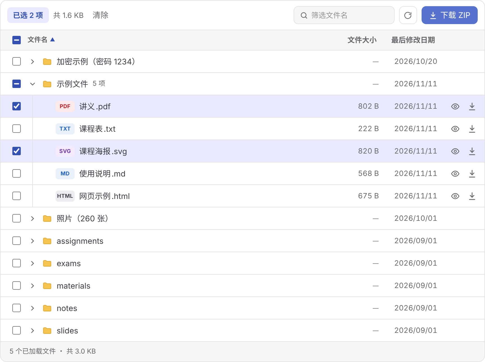

<h1 align="center">
  <picture>
    <source media="(prefers-color-scheme: dark)" srcset="https://raw.githubusercontent.com/nrjycyd/filelist/main/demo/docs/public/wordmark-dark.svg?sanitize=true">
    
  </picture>
</h1>

<p align="center"><a href="./README.md">English</a> · 简体中文</p>

<p align="center">面向 VuePress 2 的 OpenList 文件浏览组件：在文档页里浏览、预览、批量下载 OpenList 上的文件。</p>

<p align="center">
  
</p>

这是 [vitepress-plugin-filelist](https://www.npmjs.com/package/vitepress-plugin-filelist) 的 VuePress 版：同一个组件、同一个版本号，一起发布。

## 安装

```bash
pnpm add -D vuepress-plugin-filelist
```

```ts
// .vuepress/config.ts
import { viteBundler } from '@vuepress/bundler-vite'
import { defineUserConfig } from 'vuepress'
import { fileListPlugin } from 'vuepress-plugin-filelist'

export default defineUserConfig({
  bundler: viteBundler(),
  plugins: [fileListPlugin()],
})
```

然后在任意页面：

```md
<FileList base="https://pan.example.com" path="/课程资料" />
```

已在 `@vuepress/bundler-vite` 下测试默认主题、vuepress-theme-plume、vuepress-theme-hope，配色和亮 / 暗跟随主题。

## 文档

👉 **[在 VuePress 中使用](https://nrjycyd.github.io/filelist/guide/vuepress)**，全部属性见 [组件属性](https://nrjycyd.github.io/filelist/reference/props)。

## 更多

[更新日志](../../CHANGELOG.md) · [MIT License](./LICENSE)
